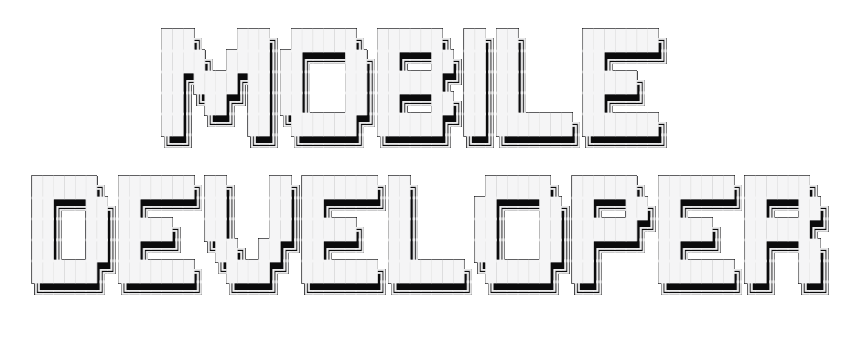

<h1 align="center">Hola, soy Fernando</h1>

  

<h1>Acerca de mí</h1>

En 2020 comencé mis estudios con un Grado Medio en Sistemas Microinformáticos y Redes, y posteriormente continué hacia el Grado Superior en el que me estoy formando actualmente. Me considero un apasionado del desarrollo de aplicaciones, en camino a seguir aprendiendo y enriqueciendo mis conocimientos.

[Curriculum Vitae](fernandoguerracv.pdf)

<h1>Conocimientos adquiridos en Grado Medio y Superior</h1>

A lo largo de mi trayectoria en estos dos Grados, he adquirido diversos conocimientos en el campo de la informática. He desarrollado habilidades en el uso de aplicaciones de ofimática y he tenido la oportunidad de crear páginas web simples utilizando HTML y CSS. Además, he trabajado con JavaScript en diversos proyectos y, posteriormente, me sumergí en la programación en Java. También he tenido experiencia con PHP y la gestión de bases de datos.

<h1>Experiencia FCT</h1>

Escola Oficial d’idiomes (c. Vic, 3, 08223 Terrassa)

2021- 2022

Durante mis prácticas de Formación en Centros de Trabajo (FCT) durante el Grado Medio, realicé algunas tareas básicas:

- Reparación de impresoras, computadoras y otros tipos de hardware.
- Elaboración de hojas de cálculo para la gestión de notas del alumnado.
- Soporte en programación de software.
- Resolución de incidencias en las computadoras de las aulas.

<h1>Lenguajes Y Tecnologias💻</h1> 

Estos son algunos lenguajes y tecnologias con las que he trabajado durante CFGM y CFGS

        

<h1>Contacto</h1>

- feragd14@hotmail.com

